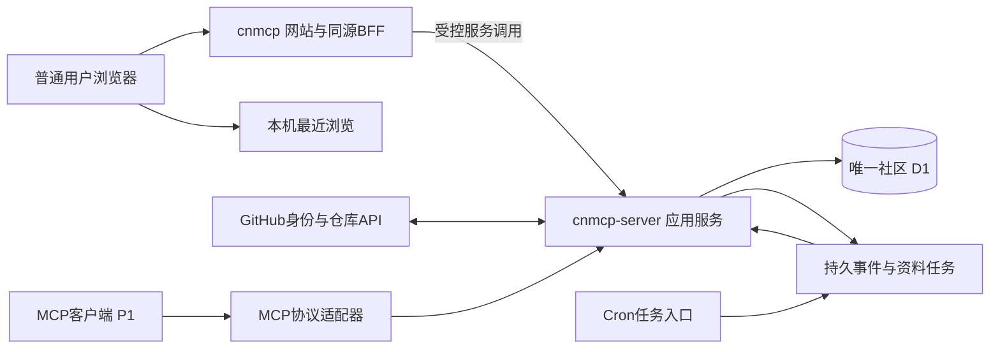
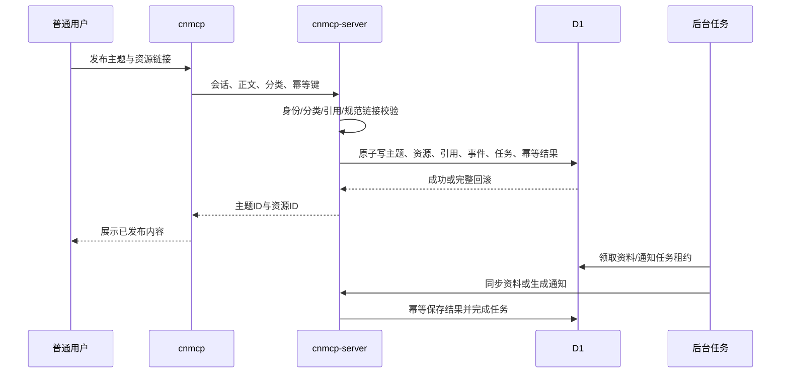

# CNMCP 项目架构设计

架构版本 1.0 · 2026-11-18。对应产品 PRD 2.0、数据库基线 2.1 及最终普通用户原型。本文描述目标架构和实施边界。

## 直接执行

### 1. 核心决策

**两个仓库、两个主要部署单元、一个业务后端、一份权威数据。**

- **cnmcp**：公开网站、页面交互、服务端页面渲染与薄转发层，维护可公开的接口契约和设计材料。
- **cnmcp-server**：私有应用后端，统一实现业务API、普通用户鉴权、数据持久化、资料任务、站内通知与后续MCP入口。

网站和MCP共享 cnmcp-server 的应用服务，不各自实现搜索、资源归一、引用计数或订阅。MCP 是协议适配入口，不是另一份资源目录或另一个用户体系。

### 2. 现状与目标的区别

| 项目 | 当前仓库情况（只说明现状） | 重构目标 |
| --- | --- | --- |
| cnmcp | Next.js 网站、旧 Worker API、旧资源检查/采集模块；新社区目前在独立原型中 | 网站、薄BFF、共享公开契约；旧业务API和旧检查流程退出新产品路径 |
| cnmcp-server | 私有 Worker + D1，以旧 CMS 内容和内部接口为主 | 唯一普通用户社区后端；不建设/复用 CMS 作为本版用户界面 |
| 数据 | 两边旧 Worker 各有数据库绑定；新DDL只在本地验证 | 新建一份社区数据库，由后端独占绑定和迁移 |

不依赖旧表、旧CMS内容或旧检查数据，不做兼容迁移。现有部署文件和线上路由本轮未改；旧代码中存在 admin 路由，不意味着它属于定稿产品。正式切换前必须明确停用它们，不能只把入口藏起来。

### 3. 系统关系



初期使用现有 Cloudflare Workers + D1 和 TypeScript/Hono 后端基础，网站沿用 Next.js。异步任务先由持久化任务表与 Cron 驱动；有吞吐需求再接 Queues，消费者仍调用同一应用服务。无需为每个模块增加独立服务、数据库或搜索集群。

Workers 间优先使用 Service Binding，实现受控调用；其能力和接口以[官方说明](https://developers.cloudflare.com/workers/runtime-apis/bindings/service-bindings/)为准。绑定提供服务间通道，用户身份仍由后端会话/授权校验，不能用绑定存在代替用户授权。

### 4. 职责矩阵

| 能力 | cnmcp | cnmcp-server |
| --- | --- | --- |
| 概览、主题、资源、发布、工作台、侧栏 | 页面、交互、可访问性、SEO | 返回业务数据与授权结果 |
| 领域/节点/标签 | 展示及即时输入提示 | 权威分类与有效组合校验 |
| Markdown/资源引用 | 编辑器、预览、链接呈现 | 解析、规范化、建档、引用关系和安全输出策略 |
| 登录/退出 | 登录入口、站内回跳、受控Cookie转发 | OAuth交换、state、稳定身份、会话哈希和撤销 |
| 主题/回复/评论 | 表单状态、错误和重试 | 所有权、版本、幂等、事务和可见性 |
| 搜索、列表、今日热议 | 输入与结果展示 | 统一查询、排序、时间边界和公共缓存策略 |
| 收藏、关注、通知、反馈 | 用户交互与个人页面 | 唯一事实关系、隔离读取、可靠通知 |
| 最近浏览 | 本机记录、去重、清空、显示 | 按ID读取公开资料/可见性；不存访问历史 |
| GitHub Star/资料 | 状态和来源展示 | 密钥、采集任务、可信来源、失败重试和快照 |
| MCP P1 | 网站说明和用户授权页面 | 协议适配、授权校验、工具和订阅服务 |
| 数据库 | 不绑定业务D1，不执行SQL迁移 | 单一DDL/迁移/备份与数据写入所有权 |
| 公开契约 | 请求/响应类型、错误码、契约测试与合成fixtures | 实现契约并兼容已发布版本 |
| 管理后台 | 不提供 | 本版不提供；旧CMS不是新产品功能 |

### 5. 目录与代码依赖

建议目标结构，目录名可在实施时做机械调整，不改变职责：

```text
cnmcp/
  apps/web/                 页面、同源BFF、SSR/SEO
  packages/contracts/      可公开的DTO、校验schema、错误码、API契约
  design/                  当前PRD、架构、界面规范与数据库设计
  design/prototype/        冻结的可运行原型与验收结果

cnmcp-server/
  src/http/                HTTP路由与请求适配
  src/auth/                GitHub登录、会话、对象授权
  src/application/         发布、引用、互动、通知等用例
  src/domain/              领域规则与资源身份规则
  src/repositories/        D1参数化查询与原子写入
  src/jobs/                资料任务和事件通知分发
  src/mcp/                 P1工具与订阅协议适配
  migrations/community/    新空库唯一迁移链
  tests/                   业务、事务、鉴权及契约测试
```

当前 packages/schema 是旧产品模型；新公开契约应建立清晰版本边界，不把旧结构直接重命名为新模型。后端按版本依赖公开契约包，单向依赖；公开仓库不依赖私有源码或私有仓库路径。契约使用合成数据，不包含生产导出、密钥或私有实现。

现有 apps/api 的业务实现应在实施阶段被新后端替代并退出部署。网站薄BFF直接位于 apps/web 的同源路由中，不保留一个能独立写库的第二后端。旧 registry/doctor/probe 及可信检查模块不纳入这版社区MVP。

迁移由私有仓库的 `migrations/community` 管理。公共仓库在 `design/database` 保留关系说明及迁移入口。

### 6. API 契约草案

浏览器访问网站同源 `/api/v1/*`；BFF转发到后端 `/v1/*`。以下是待实现契约，不代表当前线上地址已可调用。

| 接口 | 身份与职责 |
| --- | --- |
| GET /v1/taxonomy | 公共领域、平级节点/标签及适用关系 |
| GET /v1/overview?domain= | 领域概览，分别返回 recentTopics≤6 和 recentResources≤3；拒绝节点/标签筛选 |
| GET /v1/topics | 公共主题，domain/node/sort/unanswered/cursor |
| GET /v1/topics/:id | 公共详情、回复及去重资源引用；不可用时不泄漏正文 |
| POST /v1/topics | 登录发布，Idempotency-Key；正文内新链接由应用服务创建资源 |
| PATCH /v1/topics/:id | 作者编辑，expectedVersion + 幂等键；冲突409 |
| POST /v1/topics/:id/replies | 登录开放式回复，校验引用回复同主题 |
| GET /v1/resources | 公共领域/标签/类型/排序列表；无页内隐藏关键词条件 |
| GET /v1/resources/:id | 公共档案、独立评论及信号 |
| GET /v1/resources/:id/discussions | 可见反向主题，按主题去重 |
| POST /v1/resources/:id/comments | 登录评论，可附相关主题ID；不写主题回复 |
| GET /v1/search | 公共统一搜索，query/domain/kind；分别返回主题和资源 |
| GET /v1/sidebar | 公共当前领域今日热议和待回应数量，不混入个人信息 |
| GET /v1/me | 当前用户资料与私人卡片计数，no-store |
| GET /v1/me/bookmarks / followed-topics / topics / replies / drafts / discoveries | 各自独立的当前用户集合，禁止指定他人user_id |
| PUT/DELETE /v1/me/bookmarks | 登录收藏/取消，显式目标类型和ID |
| PUT/DELETE /v1/me/followed-topics/:id | 开始或结束 `topic_follows` 关注区间 |
| PUT/DELETE /v1/me/helpful-votes | 回复或资源评论的有帮助反馈/撤销 |
| POST/PATCH/DELETE /v1/me/drafts[/id] | 私有草稿，保存不创建公开引用；删除仅本人 |
| GET /v1/me/notifications | 个人通知和未读筛选 |
| PATCH /v1/me/notifications/read | 明确通知ID集合或全部，服务端按本人限制 |
| PATCH /v1/me/preferences | 普通用户浅色/深色偏好 |
| POST /v1/reports | 普通反馈回执，幂等；不暴露处理台 |
| GET /v1/me/reports/:id | 仅本人已提交反馈回执，不含内部处理数据 |

详情GET返回公共数据；是否已收藏/关注等私人状态通过当前用户接口读取，避免带Cookie的共享缓存污染。错误格式统一 `{error:{code,message,requestId,fieldErrors?}}`；主要状态码400/401/403/404/409/429。需要幂等的成功写入把资源ID等非敏感结果存入同一事务，不记录会话Cookie。

主题使用时间+ID游标，资源首版使用受限页码/页大小（默认20、上限30），排序变化重置分页。检索不承诺语义搜索；关键词匹配逻辑由同一后端实现。今日边界统一 Asia/Shanghai，响应带 timezone、windowStart、windowEnd、generatedAt，客户端不自行重算榜单。

所有配置/可见性字段均由后端维护，不接受普通用户PATCH全站资源字段。反馈回执和用户私有集合不经过公共缓存。

### 7. 普通用户登录与信任边界

1. 浏览器访问同源 `/auth/github/start`，BFF调用后端生成一次性state及浏览器绑定，后端生成受限制的回跳路径。
2. 重定向到GitHub；回到预先登记的同源 `/auth/github/callback`，BFF转交code/state和受控Cookie。
3. 后端按提供方和浏览器绑定原子消费登录 state，交换 GitHub code，通过 `user_identities` 用稳定 GitHub ID 找到站内账号并创建会话。首次登录同批创建站内账号和身份。会话凭据只存哈希。
4. BFF只转发允许的认证Cookie属性，设置 Secure、HttpOnly、SameSite=Lax、Path=/，不接受任意上游Domain和浏览器自报用户头。
5. 写请求校验有效会话、账号状态、对象归属及CSRF/Origin。退出撤销服务端会话并删除浏览器Cookie。

GitHub client secret、资料访问Token和DB绑定只在 cnmcp-server；浏览器不见 SERVICE_TOKEN 或数据库权限。服务间认证与用户认证分开，禁止通过普通请求的 X-User-Id 声明身份。登录state回跳除SQL的基本限制外，还须拒绝反斜线、编码绕过、外部scheme和非白名单目标。

HTTP MCP 使用单独的用户授权和访问令牌校验，不能把网站Cookie或GitHub token当作通用MCP令牌。按实施时选定的[官方授权规范](https://modelcontextprotocol.io/specification/2025-06-18/basic/authorization)冻结协议版本、资源受众、作用域和撤销策略；本文未实现授权服务器。

### 8. 关键链路



链接并发冲突必须回滚并复用胜出资源；作者编辑使用版本保护，版本失败不能继续重建引用。后端生成写入nonce，在条件UPDATE后以幂等结果表的2xx约束作为提交守卫，不命中版本时强制整批失败；具体约束与测试见数据库说明。D1 的 batch 行为见[官方API](https://developers.cloudflare.com/d1/worker-api/d1-database/#batch)，服务层还需实现冲突重试和成功条件检查。

资料首版主动同步GitHub可信API；未知HTTPS先保存，不执行任意外站内容抓取或工具安装。任务失败不撤销用户内容，Star失败不覆盖上次成功快照。通知来自持久化事件，不依赖一个可能中断的临时请求后台回调。

### 9. 数据、缓存与搜索

- 一个环境一份新的社区D1，只由 cnmcp-server 绑定；cnmcp不直接访问D1。预览/测试/生产环境数据隔离。
- 实体模型见[数据库说明](database/README.md)：26表、4视图，没有运营角色或历史浏览表。
- 公共列表与分类可短缓存；主题/评论写入后刷新相关列表和档案，短TTL仅作回退。个人状态、通知、草稿、反馈和OAuth响应 no-store。
- 首版使用受限字面关键词查询和索引，不引入向量库或重复索引服务。增长后引入搜索索引时，索引仍是可重建副本，由事件驱动，不成为第二份事实源。
- 最近浏览由浏览器记录类型/ID/上下文/时间，不保存正文。展示前按公共API校验当前可见性；API失败时显示暂不可用，不擅自永久清除历史。
- 原始源信息与社区意见分别存储和展示，资源引用不继承分类，也不复制评论。

### 10. MCP P1 职责与契约

cnmcp-server/src/mcp 仅做输入schema、协议错误/结果封装及授权适配，然后调用同一应用服务。首批工具建议：

| 工具 | 业务服务 |
| --- | --- |
| list_taxonomy | 分类读取 |
| search_topics / search_resources | 网站共用搜索 |
| get_topic / get_resource | 公共详情 |
| list_resource_discussions | 去重反向引用 |
| create_subscription / list_subscriptions / cancel_subscription | 已授权用户自己的订阅 |
| read_subscription_events | 已授权用户订阅对应的可见事件增量 |

P0 网站主题关注使用 `topic_follows` 生成站内回复通知。P1 再设计 MCP 查询订阅的持久化，复用同一套账号、业务对象和事件水位。订阅管理须验证用户、作用域及对象归属。初始水位和拉取游标分别记录，游标与用户及订阅绑定。返回事件前重新校验当前内容可见性。客户端可按游标重试拉取。

公开MCP地址可规划为 `https://api.cnmcp.com/mcp`；这是目标地址，当前未配置或上线。具体协议版本、授权系统与令牌持久化在P1确定并验收，不通过预建几个空表伪装已完成。

### 11. 部署、验证与实施顺序

1. **冻结契约和新库**：定稿文档与SQL审阅；单向发布公开契约；将唯一SQL移交后端新迁移目录；新建独立空库，不使用旧迁移链。
2. **后端核心**：普通OAuth/会话、分类、主题/回复、资源/来源/引用/独立评论、幂等和版本控制。
3. **网站接入**：依据冻结原型实现生产页面，通过同源BFF调用后端，替换本地演示数据。
4. **互动与任务**：收藏、关注、有帮助、草稿、通知、反馈、GitHub资料、可靠任务和真实今日热议。
5. **退出旧运行路径**：关闭旧API/CMS及旧探测入口，移除重复DB写权限；新路由通过后再切流。保留的是部署可回退能力，不是旧数据兼容层。
6. **P1 MCP**：协议适配、公开检索、标准用户授权、订阅游标与可见性验收，再发布入口。

用户单元只需要网站Worker与后端Worker；Cron属于后端入口。现有 `cms.cnmcp.com/admin`、旧 `api.cnmcp.com` 和两个旧D1绑定都不能未经配置变更就当作目标架构。环境密钥、域名切换和远端DDL应用属于后续显式发布步骤，本轮未执行。

最低检查：DDL/查询、用户隔离、草稿/通知越权、OAuth state重放、CSRF、并发来源去重、编辑冲突全量回滚、幂等请求、任务租约恢复、无隐藏内容泄漏、普通用户页面E2E，以及MCP和网站查询结果一致。公共契约更新后两仓库CI都运行契约测试；网站不能因类型编译通过就假设私有后端已部署。

### 12. 决策记录

| 决策 | 原因与代价 |
| --- | --- |
| 唯一业务后端在 cnmcp-server | 避免两个仓库双写、重复鉴权和不一致检索；需要一次性退出旧apps/api |
| 网站采用薄BFF | 同源会话和SSR更清楚；转发层必须保持无业务规则和无DB权限 |
| 新空库而非兼容迁移 | 用户已明确无旧用户数据保留要求；部署时仍需明确新环境与切流，不能误用旧迁移 |
| 本机最近浏览 | 对齐原型、低成本和最少个人数据；首版无跨设备同步 |
| 无运营产品流程 | 聚焦普通用户闭环；分类初期靠版本化配置，未分类新资源可能只在全部领域出现 |
| 持久任务+Cron起步 | 重试可靠且少依赖；吞吐扩大再接队列，不能用临时回调替代可靠任务 |

## 深度交互

真正需要统一的是身份、内容、资源身份和互动事实，而不是把所有代码放进一个公开仓库或按功能创建微服务。两个项目的边界一旦定为“网站”和“权威后端”，MCP、资料任务及网站查询可以复用同一规则，私有实现也不会经共享类型包流入公开仓库。

首版最容易变重的部分是分类维护、全文搜索和订阅推送。保留版本化分类、普通关键词搜索与游标拉取，先获得真实讨论与反馈；若这些限制形成可观察的障碍，再增加对应能力。所有目标能力与目前仅本地演示的部分在PRD和实施顺序中明确分开。
