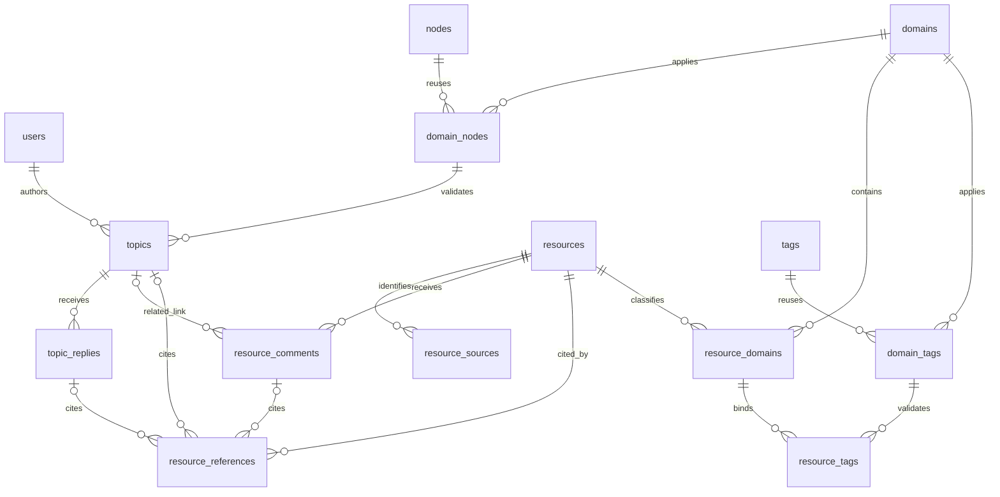
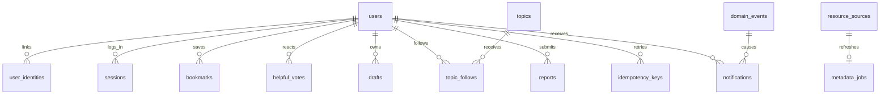

# CNMCP 普通用户数据库设计 · 定稿

数据库基线 2.1 · 2026-11-18。对应 [定稿 PRD](../PRD.md) 与 [项目架构](../ARCHITECTURE.md)。

## 直接执行

### 1. 基线与文件

这是 **新空库设计**，不是旧表增量迁移；不执行线上清库，不叠加 apps/api/migrations 或旧 CMS 迁移。当前设计权威文件仍在此目录；生产落地时一次性移交 cnmcp-server 的新库迁移目录，之后只在后端维护 SQL，不长期保留两套迁移源。

| 文件 | 内容 |
| --- | --- |
| `migrations/community/0001_schema.sql` | 26 张业务和基础表、4 个可见性读取视图及约束索引 |
| `migrations/community/0002_taxonomy.sql` | 六个首发领域及适用节点、标签 |
| `migrations/community/0003_hellogithub.sql` | 100 条首发资源及来源 |
| `src/queries.sql` | 命名查询，覆盖列表、概览、个人数据和通知接收者 |
| `src/writes.sql` | 关注、取消关注和 OAuth state 消费的原子 SQL |
| `tests/test_schema.py` | 在内存 SQLite 中验证行为和约束 |

在私有后端仓库运行 `python3 tests/test_schema.py` 验证。ID 使用应用生成的 UUID/ULID，时间统一 UTC Unix 秒；原型毫秒值不能直接写库。生产站点日界线为 Asia/Shanghai，查询仍绑定 UTC 秒。

D1 作为现有 Cloudflare 部署下的轻量关系库选择，外键保持启用；多语句写入通过参数化 batch 完成，异常回滚。[D1 外键](https://developers.cloudflare.com/d1/sql-api/foreign-keys/)、[batch 说明](https://developers.cloudflare.com/d1/worker-api/d1-database/#batch)。本地 SQLite 验证不等于已通过远端 D1 集成测试。

### 2. 基线 2.1 的调整

- `users` 保存站内账号，`user_identities` 保存第三方身份。`oauth_login_states` 绑定发起登录时使用的提供方。
- `resource_sources` 保存仓库身份与最新 Star 快照。`metadata_jobs` 以 `source_id` 为主键。
- P0 `topic_follows` 保存主题关注区间。领域、节点、资源和关键词订阅归入 P1。
- 领域、节点和标签分表。主题通过复合外键校验领域节点组合，草稿额外保留单列领域外键以支持只选领域。字典表的 `sort_order` 用于全站导航，关联表的 `sort_order` 用于具体领域内的顺序。

### 3. 表字典与归属

全部生产表由 cnmcp-server 独占写入；cnmcp 网站和 MCP 不能另建业务主表。

| 表 | 主要字段与用途 | 关键约束 |
| --- | --- | --- |
| users | handle、display_name、avatar_url、bio、theme_preference、status | 站内 `id` 关联内容、会话和互动；`handle` 为站内唯一用户名 |
| user_identities | provider、provider_subject、user_id、created_at | `PRIMARY KEY(provider,provider_subject)`；一个站内账号可以关联多个第三方身份 |
| sessions | user_id、token_hash、expires_at、revoked_at | 仅存令牌哈希；服务端检查有效期、撤销与用户状态 |
| oauth_login_states | state_hash、provider、browser_binding_hash、return_path、expires_at、consumed_at | 哈希定长、绑定提供方和浏览器、单次原子消费；返回地址由服务端校验 |
| domains | slug、name、description、sort_order、status | 浏览及资源归属范围。归档后保留历史内容 |
| nodes | slug、name、description、sort_order、status | 平级、全站唯一，无 parent_id |
| domain_nodes | domain_id、node_id、sort_order | 组合主键；同节点可适用多个领域 |
| topics | domain_id、node_id、author_id、title、body、progress_note、version、last_write_key、visibility、时间 | 有效领域节点复合外键；标题4–100，正文≤12000，反馈≤4000；编辑按 version 比较 |
| topic_replies | topic_id、author_id、quote_reply_id、body、visibility、created_at | 正文1–4000；引用回复不能跨主题 |
| resources | slug、name、summary、kind、created_by、visibility、code_license、weights_license | 全站唯一档案，无质量等级/总分；新链接默认 link，不因资料不全隐藏 |
| resource_sources | resource_id、provider、canonical_key、canonical_url、external_id、metadata_json、stars、stars_observed_at | 规范键和已知提供方外部 ID 各自去重。仅 GitHub 来源可成对保存 Star 和观察时间。每资源最多一个主来源 |
| resource_comments | resource_id、author_id、quote_comment_id、referenced_topic_id、body、visibility | 独立评论；评论引用不能跨资源；相关主题链接不贡献讨论引用 |
| resource_references | resource_id、topic_id / topic_reply_id / resource_comment_id | 恰好一个来源；同来源同资源唯一，正文多次提及仍只记一条边 |
| resource_domains | resource_id、domain_id | 资源多领域；允许尚未分类的新资源零领域 |
| tags | slug、name、description、sort_order、status | 平级资源标签，全站唯一 |
| domain_tags | domain_id、tag_id、sort_order | 标签领域适用关系 |
| resource_tags | resource_id、domain_id、tag_id | 两个复合外键同时保证资源归属及标签适用关系，三列去重 |
| bookmarks | user_id、topic_id / resource_id | 目标二选一，同用户同对象唯一；撤销删除关系 |
| helpful_votes | user_id、topic_reply_id / resource_comment_id | 目标二选一，同用户同反馈对象一次；可撤销 |
| drafts | user_id、domain_id、node_id、editing_topic_id、title、body、updated_at | 私有；分类可不完整；节点必须依赖领域并构成有效组合，不产生公开引用 |
| topic_follows | user_id、topic_id、start_event_id、end_event_id、created_at | 每个用户与主题组合最多一个未结束区间，历史区间用于异步通知 |
| domain_events | 单调id、dedupe_key、event_type、actor_id、单目标、通知分发状态/租约 | 单目标与事件类型匹配；不复制正文；与业务事实同一事务写入 |
| notifications | recipient_id、event_id、reason、read_at | UNIQUE(recipient_id,event_id)，避免作者与关注者双命中重复提醒 |
| reports | reporter_id、单目标、reason、detail、created_at | 普通用户提交回执；目标恰好一个，无处理人/运营审计字段 |
| metadata_jobs | source_id、state、attempts、run_after、lease_until、last_error | `source_id` 同时是主键与外键，每来源一个可恢复任务 |
| idempotency_keys | user_id、scope、request_key、request_hash、response_status、response_json、expires_at | 用户+操作+键唯一；成功结果与业务写入原子持久化，不存会话令牌 |

完整字段、默认值、长度及外键以私有后端的 `0001_schema.sql` 为准。没有登录态的“游客”不建 users 行。GitHub 授权只做身份识别，后端交换后不因登录需要长期保留 GitHub access token。

### 4. 核心关系

三条引用来源关系是三选一，不是一条引用可同时拥有三个来源。资源评论的 referenced_topic_id 与引用边是不同关系，前者只提供相关阅读链接。

### 5. 查询与计数契约

| 查询/视图 | 契约 |
| --- | --- |
| topic_list | 领域+节点；最新按创建时间，活跃按最后有效活动；时间+ID游标；待回应过滤独立 |
| overview_topics / overview_resources | 只有领域，分别最多6/3条按创建时间排序，禁止拼成混合 UNION 结果 |
| resource_list | 领域+适用标签+类型；互动/Star/最新排序；单资源最多一行，首版页码分页 |
| today_hot | 依据回复发生时间 [day_start,day_end)，排除未来和隐藏回复，按今日回复数排序，最多5条；不限制主题必须今天创建 |
| member_card | 只读取请求者自己的可见收藏、站内关注、主题及未读通知 |
| private_followed_topics / private_notifications / private_drafts | user_id 来自后端会话，不接受客户端声明另一个用户 |
| reply_notification_recipients | 以事件 ID 查询可见回复通知的接收者。匹配事件发生时的关注区间，排除发起人，作者优先 |
| search_topics / search_resources | 共享的字面关键词查询；网站顶栏与 MCP 共用；不是资源页的额外搜索框 |
| v_topic_resource_references | 主题正文与可见回复的引用并集，按主题+资源去重 |
| v_topic_reply_counts | 主题自己的可见回复；不包含资源评论 |
| v_resource_signals | 去重讨论引用、独立评论、有效用户收藏/评论有帮助，以及选定 GitHub 来源的 Star、观察时间与 URL |
| v_public_domain_events | 每次读取重新校验目标与父对象可见性，用于通知和后续 MCP 读取 |

上限和排序枚举由服务端白名单校验；SQL 参数绑定，普通用户输入不参与拼接。资源标签用 EXISTS，避免多个领域/标签 JOIN 导致重复档案。资源页不使用隐藏的 q 条件；需要搜索时进入全站搜索。

初期计数来自事实关系和索引查询，不建不可校验的热度缓存。流量增长后可增加可重建的日聚合，仍以回复时间和可见性为依据。生产查询不使用原型的演示相对时间规则。

### 6. 写入与事务

**发布/回复/评论**：鉴权及长度/分类/对象状态校验 → 为写入分配幂等键与对象ID → 解析/规范化链接 → 复用或创建资源/来源 → 写正文和结构化引用 → 写 domain_events 和适用 metadata_jobs → 保存成功幂等结果 → 原子提交。

创建资源时同批写入首条主来源。GitHub 来源的规范键使用小写仓库路径，稳定仓库 ID 写入 `resource_sources.external_id`。

同来源并发由 canonical_key 唯一约束裁决；冲突后回滚、读取已有资源并重试完整提交，不能保留孤儿资源。幂等键在同用户同操作中携带同 request_hash 才能重放成功结果，不同内容返回409；成功记录保留24小时，过期清理后允许重用。OAuth/登录响应不进入普通写入幂等表。

**编辑**：仅作者可操作。后端生成不可由客户端指定的随机 write nonce；batch首先以 id+author_id+expectedVersion 条件UPDATE正文、version+1及last_write_key。紧接着插入本次幂等结果，response_status使用 `CASE WHEN 本主题last_write_key=本次nonce THEN 200 ELSE 0 END`。0违反2xx CHECK并令整批回滚；不能只依赖UPDATE零行的返回值。之后才写资源、替换引用和事件，任何后续唯一键冲突同样回滚前面的正文/版本/幂等记录。失败再区分归属、版本冲突和同请求重放。此机制已在SQLite事务中测试，远端D1 batch仍需集成验收。

**主题关注**。关注和取消关注的 SQL 在各自更新关系的同一条语句读取当前事件水位，空库水位为 `0`。通知匹配 `start_event_id < event_id <= end_event_id`，结束水位为空代表仍关注。取消前已发生的事件即使延迟处理也能投递。重新关注创建新区间。清理已结束的区间前，须确认区间内待处理的通知事件已经处理完成。若将来按保留期清理事件，保留最新事件可防止 `MAX(id)` 水位回退。

**通知**。业务事务持久化事件。任务领取事件租约，通过 `reply_notification_recipients` 读取接收者，再幂等插入通知并标记完成。进程中断可在租约过期后重试。读取通知时重新检查接收者及事件目标可见性。

**登录**。发起登录时写入提供方和浏览器绑定。回调使用 `consume_oauth_login_state`，只有影响一行才继续。服务端校验 `return_path`，交换 GitHub code，再按 `('github', GitHub 用户 ID)` 查找站内账号。首次登录原子创建账号和身份，身份唯一键冲突时回滚并重新查询。以后接入 Google 可保存 `('google', 已验证 ID Token 的 sub)`。将新身份绑定到已有账号需要由已认证用户发起。站内 `handle` 与第三方用户名各自维护，会话只关联站内账号和 `token_hash`。

常见同源URL去重由规范键保证；仓库更名、跨来源同项目等别名归并尚非本版已实现能力。发现稳定外部ID冲突时保留现有资源与讨论，任务记录冲突，不静默覆盖或丢弃评论；完整合并/重定向方案以后单独定义。

**资料任务**：只对首版支持的可信来源（优先 GitHub API）主动补资料；未知外站先留链接，不承诺抓取。失败记录错误并安排重试，保留上次成功 Star 和时间，不能写成0或假装刚同步。资料补齐和资源公开是独立过程。

展示 Star 时优先选择标记为主来源的 GitHub 仓库。若没有主 GitHub 来源，选择最早加入的 GitHub 来源，同秒按来源 ID 排序。选定来源的 Star、时间和 URL 一起读取。存在 GitHub 来源但还未采集时，URL 有值且 Star 为 `NULL`。没有 GitHub 来源时三者都为 `NULL`。

### 7. 归属、可见性与配置

- 所有普通写入、草稿、互动、反馈、通知均由后端校验用户和归属；不依赖前端隐藏按钮。
- topics、回复、资源、评论保留 visible/hidden/deleted，服务全站读取一致性；本版不提供人工隐藏/恢复产品页面。
- 领域/节点/标签通过版本化配置初始化，普通用户不能直接修改；已有内容引用的适用关系不能被级联删除。
- 资源不从引用继承领域/标签。暂未分类的新链接在全部领域和详情可见，具体领域不展示。
- 私有草稿的资源引用不进入公开统计；账户状态不授予管理角色。
- 首版不为本机浏览历史、积分、运营人员或质量认证建表。

### 8. MCP 订阅

P0 通过 `topic_follows` 提供站内主题关注。P1 实现 MCP 订阅时再确定持久化结构，覆盖领域、跨领域节点、领域加节点、主题、资源和关键词。关键词有节点限制时只匹配主题事件。只有领域限制时可匹配该领域主题及资源。

P1 使用与用户和订阅绑定的增量游标，并在返回前校验归属和可见性。HTTP MCP 的用户授权与令牌生命周期在 P1 单独设计。网站的 `topic_follows` 负责站内回复通知，MCP 订阅负责用户授权下的增量读取。

### 9. 验证与实施

35 项内存数据库检查覆盖分类外键、多提供方身份、Star 来源和快照约束、关注区间、通知接收者、OAuth 提供方绑定及既有查询和约束。

这些测试验证 DDL 和查询契约；服务端登录、CSRF、并发提交、授权、任务恢复和 D1 原子编辑仍需实现及集成验收。新库落地由 cnmcp-server 管理单一迁移链；未对远端应用本文件。

## 深度交互

26 张表覆盖站内账号、内容、资源和普通用户互动。P0 底层事件同时提供后续 MCP 读取所需的事件水位。

这是一套模块化后端的数据模型，不按表拆微服务。最先完成真实身份、主题/回复、资源/独立评论/引用和统一查询，再补资料与事件通知，最后接MCP，能减少重复业务实现和跨项目数据漂移。
